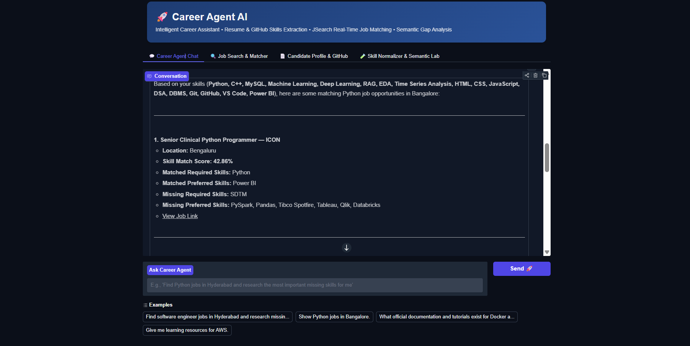
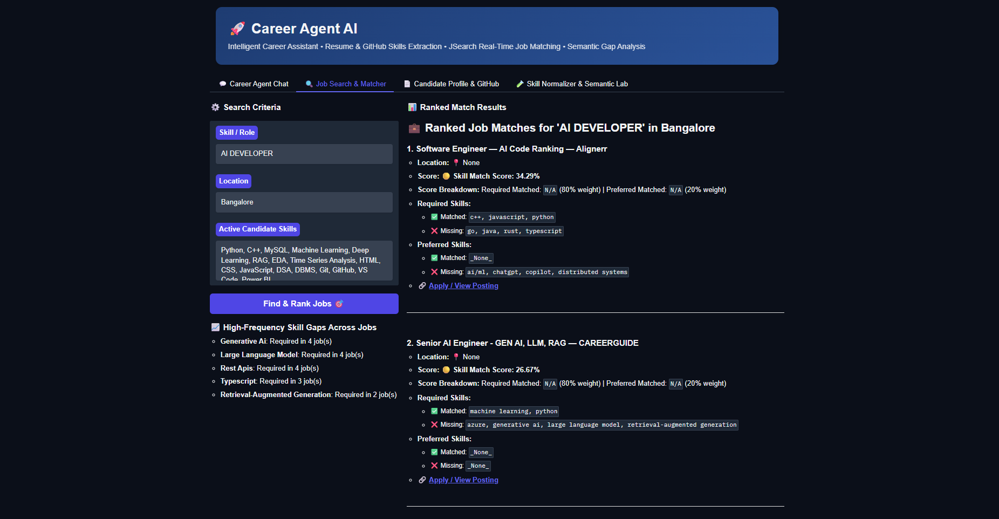
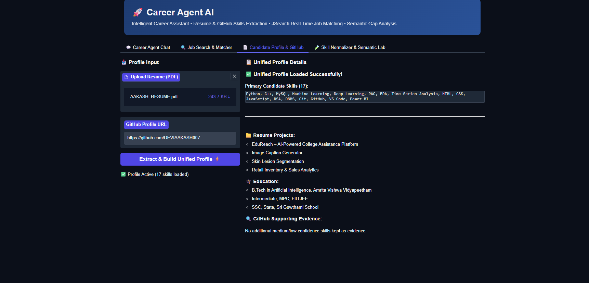

# 🤖 Agentic Job Search & Career Intelligence Agent

An AI-powered career assistant that analyzes a candidate's resume and GitHub profile, discovers relevant job opportunities, evaluates skill compatibility, identifies skill gaps, and recommends personalized learning resources.

Built using **LangChain, Gemini, Gradio, and Agentic AI**, this project aims to bridge the gap between a candidate's existing skills and real-world job requirements.

---

## 🚀 Key Features

### 1. Resume & GitHub Profile Analysis
- Upload a resume in PDF format.
- Extract candidate skills, education, and projects.
- Analyze GitHub repositories to identify additional technical skills.
- Build a unified candidate profile using resume and GitHub evidence.

### 2. Intelligent Job Search
- Search for real-time job opportunities using JSearch API.
- Search jobs based on role and location.
- Extract required and preferred skills from job descriptions.
- Analyze job requirements using an LLM.

### 3. AI-Powered Job Matching
- Compare candidate skills against job requirements.
- Identify matched and missing required skills.
- Identify matched and missing preferred skills.
- Calculate weighted job match scores.
- Rank job opportunities based on skill compatibility.

### 4. Skill Gap Analysis
- Identify missing skills across job opportunities.
- Highlight frequently requested technical skills.
- Prioritize skills based on job requirements.

### 5. Personalized Learning Recommendations
- Research missing technical skills using Tavily Search.
- Discover official documentation, tutorials, and learning resources.
- Generate recommendations based on identified skill gaps.

### 6. Skill Normalization & Semantic Matching
- Normalize different names and aliases of technical skills.
- Perform semantic skill matching using Sentence Transformers.
- Compare technically equivalent skills.

### 7. Conversational Career Agent
- Interact with an AI career assistant.
- Ask questions about job opportunities and career development.
- Get job recommendations and personalized learning guidance.

---

## 🏗️ System Architecture

```text
                  USER
                    |
                    v
             GRADIO INTERFACE
                    |
          +---------+---------+
          |         |         |
          v         v         v
       Resume    GitHub    Career Chat
       Upload    Profile       |
          |         |          |
          v         v          v
      PDF Skill  GitHub    LANGCHAIN
      Extraction Analysis    AGENT
          |         |          |
          +----+----+          |
               |               |
               v               v
        UNIFIED CANDIDATE   AGENT TOOLS
             PROFILE            |
               |          +-----+------+
               |          |            |
               v          v            v
          JOB SEARCH   JOB MATCHING  TAVILY
          (JSearch)        |        RESEARCH
               |           |
               v           v
         Job Requirement  Skill Gap
           Extraction    Analysis
               |           |
               +-----+-----+
                     |
                     v
              GEMINI LLM
                     |
                     v
          RANKED JOB MATCHES
                     |
                     v
          PERSONALIZED LEARNING
              RECOMMENDATIONS
```

---

## 🛠️ Tech Stack

| Category | Technologies |
|---|---|
| Programming Language | Python |
| LLM | Google Gemini 3.5 Flash Lite |
| Agent Framework | LangChain |
| Agentic Workflow | LangChain Agents |
| Frontend | Gradio |
| Job Search API | JSearch (RapidAPI) |
| Web Research | Tavily Search |
| Resume Processing | PyPDF |
| Semantic Matching | Sentence Transformers |
| Similarity Calculation | Cosine Similarity |
| Data Validation | Pydantic |
| API Integration | GitHub REST API |

---

## 📂 Project Structure

```text
AGENTIC_JOB_SEARCH-AGENT/
│
├── app.py
├── agent.py
├── requirements.txt
├── .env.example
├── .gitignore
│
├── agent/
│   └── agent.py
│
├── candidate/
│   ├── loader.py
│   └── profile.py
│
├── github/
│   ├── analyzer.py
│   └── extractor.py
│
├── jobs/
│   └── analyzer.py
│
├── jsearch/
│   ├── search.py
│   ├── extractor.py
│   └── job_analyzer.py
│
├── matcher/
│   ├── matcher.py
│   ├── normalizer.py
│   └── semantic_matcher.py
│
├── memory/
│   └── database.py
│
├── models/
│   └── schemas.py
│
├── profile/
│   └── profile.py
│
├── resume/
│   ├── extractor.py
│   └── parser.py
│
├── skills/
│   └── researcher.py
│
└── screenshots/
    ├── home.png
    ├── career_chat.png
    ├── job_search.png
    └── candidate_profile.png
```

---

## ⚙️ Installation & Setup

### 1. Clone the repository

```bash
git clone https://github.com/DEVIAAKASH007/AGENTIC_JOB_SEARCH-AGENT.git

cd AGENTIC_JOB_SEARCH-AGENT
```

### 2. Create a virtual environment

```bash
python -m venv venv
```

Activate the environment:

**Windows**

```bash
venv\Scripts\activate
```

**Linux / macOS**

```bash
source venv/bin/activate
```

### 3. Install dependencies

```bash
pip install -r requirements.txt
```

### 4. Configure API keys

Create a `.env` file in the project root.

```env
GEMINI_API_KEY=your_gemini_api_key
GITHUB_TOKEN=your_github_token
RAPID_API_KEY=your_rapidapi_key
TAVILY_API_KEY=your_tavily_api_key
```

### 5. Run the application

```bash
python app.py
```

Open the application in your browser:

```text
http://127.0.0.1:7860
```

## 🔄 Workflow

1. Upload a candidate resume in PDF format.
2. Provide a GitHub profile URL.
3. Extract technical skills, education, and project information.
4. Build a unified candidate profile.
5. Search for relevant job opportunities using JSearch.
6. Extract required and preferred skills from job descriptions.
7. Compare candidate skills against job requirements.
8. Calculate weighted skill match scores and rank job opportunities.
9. Identify frequently occurring missing skills.
10. Research learning resources for identified skill gaps using Tavily.
11. Interact with the Career Agent for personalized career guidance.

---

## 🔮 Future Improvements

- Integrate comprehensive RAG-based career knowledge retrieval.
- Add persistent conversational memory across sessions.
- Introduce more advanced job recommendation algorithms.
- Support additional job platforms and APIs.
- Add interactive analytics for job matching and skill gaps.
- Deploy the application on a cloud platform.

---

## 👨‍💻 Author

**Aakash**

GitHub: [DEVIAAKASH007](https://github.com/DEVIAAKASH007)

Project: [Agentic Job Search Agent](https://github.com/DEVIAAKASH007/AGENTIC_JOB_SEARCH-AGENT)

---

⭐ If you find this project interesting, consider giving it a star!

## Application Screenshots

### Career Agent Chat


### Job Search & Matcher


### Candidate Profile



NOTE:FOR EACH THING WE PROVIDED THE TEST MAKE SURE TO TEST IT AND MAKE SURE IT WORKS.